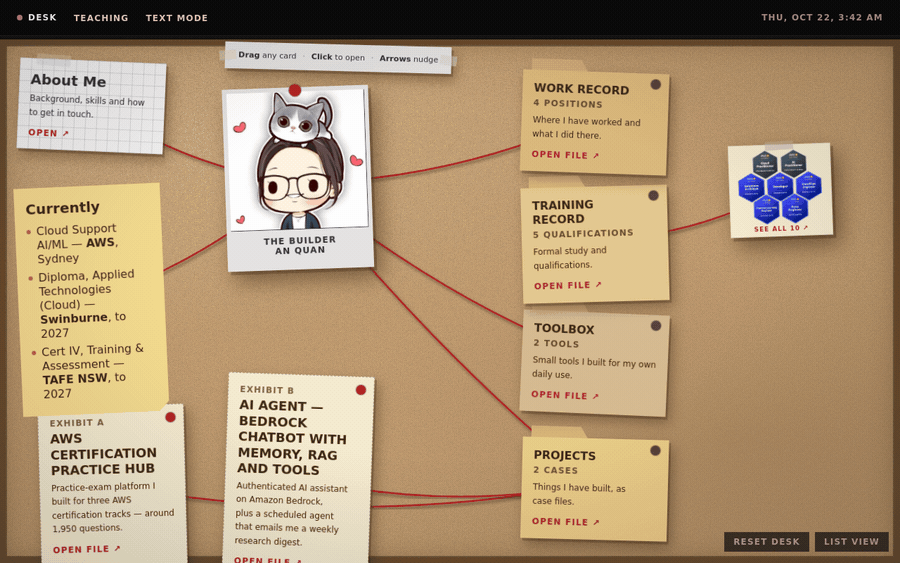

# Hi, I'm An! 👋

Welcome to my GitHub profile! I'm a developer passionate about AWS, AI, and creating engaging user experiences.
## 📊 GitHub Stats

## 🚀 My Portfolio
**[View My Complete Portfolio](https://2026portfolio-eta.vercel.app/)**

## 🎯 Featured Projects

### 🤖 MyCoolChatbot
AI-powered conversational assistant with voice synthesis and image generation
- **Tech**: AWS Lambda, Bedrock, Polly, Terraform
- **Features**: Multimodal AI, serverless architecture

### 🐱 AWS Cat Academy
Gamified learning platform for AWS certification concepts
- **Tech**: JavaScript, HTML5, CSS3, Game Design
- **Demo**: [Play Game](https://ansapple.github.io/aws-cat-academy/) 🎮

### 📚 AWS Exam Practice
Comprehensive practice exam application with 2000+ questions
- **Tech**: JavaScript, PWA, Local Storage
- **Demo**: [Try Exam](https://ansapple.github.io/aws-exam-practice/) 📝

### 📄 ExamPrep Tool
Intelligent PDF processing system for interactive practice exams
- **Tech**: Node.js, Express, PDF.js

## 🛠️ Tech Stack
- **Cloud**: AWS (Lambda, Bedrock, Polly, DynamoDB)
- **Frontend**: JavaScript, HTML5, CSS3, Responsive Design
- **Backend**: Node.js, Express
- **Tools**: Terraform, PDF.js, Game Design

## 📫 Let's Connect
- 💼 **Portfolio**: https://2026portfolio-eta.vercel.app/
- 🌐 **Live Demos**: Check out my interactive projects above!

---
*Building innovative solutions with AWS and modern web technologies* ⚡
